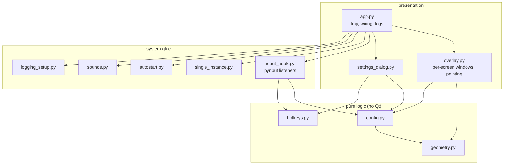
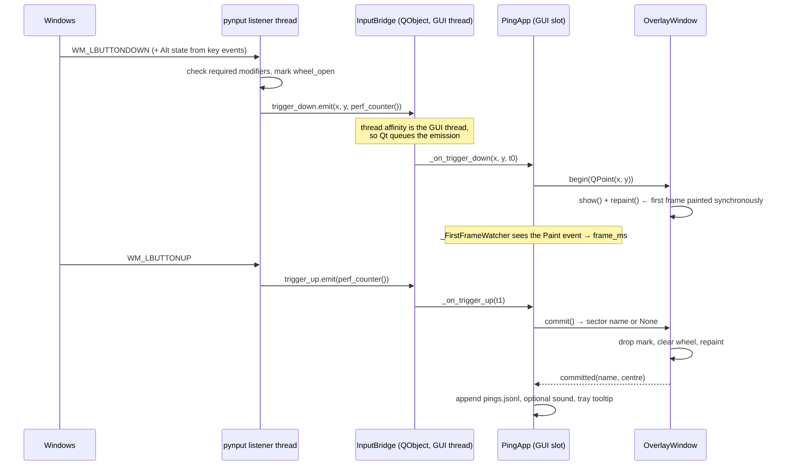
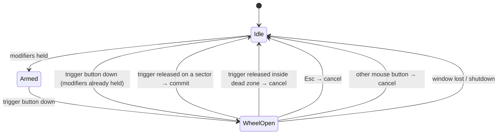

# lolping — Design Document

Version 0.2.0 · Windows 11 · Python 3.14 · PyQt5 5.15.11 · pynput 1.8.2

This document explains *how* the system is built and *why* it is built that way.
Requirements live in [`02-requirements.md`](02-requirements.md), the test
strategy in [`04-test-plan.md`](04-test-plan.md), operation in
[`05-user-manual.md`](05-user-manual.md).

---

## 1. Purpose and scope

lolping draws a League-of-Legends-style radial "ping wheel" on the Windows
desktop. Holding a trigger gesture shows a wheel at the pointer; releasing on a
slice leaves a short-lived mark on screen and records the choice.

**It is not an in-game tool.** It does not read, inject into, or draw inside the
League of Legends client, and it never sends input to another process. That
boundary is a design constraint, not an omission: it keeps the project clear of
anti-cheat and terms-of-service questions, and it makes the whole system
testable without the game running.

## 2. Design goals

| Goal | How the design meets it |
| --- | --- |
| The wheel must feel instantaneous | Global hook → queued signal → synchronous first paint; measured (`docs/04-test-plan.md` §5), not assumed |
| Never steal focus from the app underneath | `Qt.Tool` + `WindowDoesNotAcceptFocus` + `WA_ShowWithoutActivating`; no `activateWindow()` anywhere |
| Never crash on bad configuration | `Config.from_dict` is a total function: any input yields a valid config |
| A lost input hook must not be silent | Supervisor thread restarts dead listeners and reports through the tray |
| No binary assets, no Riot-owned files | Tray icon, wheel, and ping sound are generated in code |
| One screen, three screens, negative coordinates | One overlay window per `QScreen`, lazily created |
| Testable without a display or a game | Pure geometry/config modules, `--self-test`, offscreen smoke test |

## 3. Architecture

### 3.1 Layers



The dependency arrows only ever point *downwards*. `geometry`, `config` and
`hotkeys` import nothing from the project and no Qt, so they can be tested with
plain `unittest` and reasoned about in isolation.

### 3.2 Module responsibilities

| Module | Responsibility | Key public surface |
| --- | --- | --- |
| `geometry.py` | Wheel hit testing, sector angles, easing maths | `sector_index`, `sector_span`, `approach` |
| `config.py` | Schema, defaults, repair-on-load, atomic save, data paths | `Config.load/save/from_dict` |
| `hotkeys.py` | Parse/format `"ctrl+shift+q"` | `parse_hotkey`, `format_hotkey` |
| `input_hook.py` | Own the OS hooks, normalise keys, emit Qt signals, supervise listeners | `InputBridge`, `InputHook` |
| `overlay.py` | Window lifecycle, painting, animation, ping marks | `OverlayManager`, `OverlayWindow` |
| `settings_dialog.py` | Edit a `Config` with validation | `SettingsDialog.edit` |
| `app.py` | Bootstrap, tray menu, wiring, ping/latency logs, CLI | `PingApp.main`, `run_self_test` |
| `single_instance.py` | One process per desktop session | `SingleInstance` |
| `autostart.py` | `HKCU\...\Run` entry | `set_enabled`, `is_enabled` |
| `sounds.py` | Synthesised ping tone, async playback | `play_ping` |
| `logging_setup.py` | Rotating file log, excepthook | `setup_logging` |

### 3.3 Why this split

The split follows one rule: **anything that can be wrong without a screen must
not need a screen.** Hit-testing, configuration repair and hotkey parsing carry
most of the correctness risk, and all three are pure functions with unit tests.
The Qt layer is reduced to "draw what the numbers say".

## 4. Process and threading model

| Thread | Owns | Never does |
| --- | --- | --- |
| Qt GUI thread | all widgets, timers, painting, file writes for logs | call into pynput |
| pynput keyboard listener | `WH_KEYBOARD_LL` callback | touch widgets |
| pynput mouse listener | `WH_MOUSE_LL` callback | touch widgets |
| hook supervisor | liveness check, listener restart | emit trigger signals |

### 4.1 Input pipeline



Two properties matter:

1. **The hook thread never blocks on the GUI.** It only emits; the GUI thread
   decides. A slow paint can never stall the mouse hook.
2. **The emission is queued, not direct.** Because `InputBridge` is created in
   the GUI thread, Qt's `AutoConnection` turns every cross-thread emission into
   a posted event. No locks are needed around widget state.

The cost of that safety is the queue hop itself, which is exactly what the
latency probe measures instead of hiding.

### 4.2 Thread-safe input state

The hook keeps six fields behind one `threading.Lock`: pressed keys, held
modifiers, required modifiers, trigger button, quit hotkey, and `wheel_open`.
Callbacks take the lock, compute one decision, release it, and only then emit —
so no signal is emitted while a lock is held, and no slot can deadlock the hook.

## 5. Trigger state machine



| Current | Event | Guard | Next | Side effect |
| --- | --- | --- | --- | --- |
| Idle | trigger down | all required modifiers held | WheelOpen | `begin()`, arm latency probe |
| WheelOpen | trigger down | — | WheelOpen | ignored (no second wheel) |
| WheelOpen | trigger up | hovered sector ≥ 0 | Idle | `commit()`, mark, log, sound |
| WheelOpen | trigger up | hovered sector = −1 | Idle | `cancel()`, no mark, no log |
| WheelOpen | Esc | — | Idle | `cancel()` |
| WheelOpen | other mouse button | — | Idle | `cancel()` |
| any | quit hotkey | — | [*] | graceful shutdown |
| any | listener died | — | any | restart, tray warning |

Deliberate edge-case decisions:

* **Modifier released before the mouse button** still commits. The gesture was
  completed; cancelling would punish the user for finger-order.
* **A second trigger while the wheel is open is ignored**, not re-centred. A
  moving wheel is worse than a missed click.
* **Committing does not require the pointer to be *outside* the wheel's outer
  radius.** Only the inner dead zone cancels, matching the prototype's feel.
* **Releasing over a different application** still commits: the overlay window
  is on top for the whole gesture, so the pointer cannot be over anything else.

## 6. Wheel geometry

### 6.1 Angle convention

Screen coordinates grow **downwards**, so a mathematical positive angle is
*clockwise on screen*. The project therefore defines angle 0° as 3 o'clock and
increasing clockwise, which makes sector `i` centred on `i × 45°`:

```
       6  12 o'clock
    5     |     7
  4       +——–      0      ← 0° = 3 o'clock, growing clockwise
    3     |     1
       2   6 o'clock
```

### 6.2 Hit testing

```python
if hypot(dx, dy) < dead_zone:
    return -1                       # dead zone cancels
angle = degrees(atan2(dy, dx)) % 360
step  = 360 / count
return int(((angle + step / 2) % 360) // step)
```

The `+ step/2` rotation is what turns "sector boundaries at `i×45`" into
"sector *centres* at `i×45`". It is the single easiest thing to get wrong in this
project, which is why `tests/test_geometry.py` pins it with the half-open
interval property, the exact ±22.4° boundary, and a 72-point sweep.

### 6.3 Mapping to `QPainter.drawPie`

Qt measures in 1/16° **counter-clockwise** from 3 o'clock, so a clockwise
interval `[start, start + span]` becomes:

```python
painter.drawPie(rect, -int((start + span) * 16), int(span * 16))
```

`overlay.py::_sector_arc` performs this conversion once and everything else
speaks the project's convention.

### 6.4 Dead zone and labels

* Dead zone: `Config.dead_zone` (default 34 px). Inside it no sector is
  highlighted, the centre disc shows `Caution`, sector labels are hidden, and
  release cancels. This gives the user a way *out* of a gesture.
* Labels sit at `0.72 × radius` on each sector's centre line
  (`sector_label_point`), auto-shrinking until they fit the slice.
* The centre disc (radius 42) repeats the hovered sector name so the user does
  not have to read rotated text mid-gesture.

## 7. Rendering and animation

### 7.1 Frame loop

A single `QTimer` at 16 ms (~60 Hz, `PreciseTimer`) exists **per visible
window** and is stopped as soon as neither a wheel nor a mark needs drawing. An
idle lolping therefore burns no CPU on animation, which is what makes the
"idle < 1% CPU" requirement achievable.

### 7.2 Exponential smoothing, not a tween

Each sector has a weight in `[0, 1]` that chases its target every frame:

```
α = 1 − exp(−dt / τ)          τ = Config.animation_tau (default 35 ms)
w ← w + (w_target − w) · α
```

Why this instead of a fixed-duration tween:

* **Frame-rate independent.** The same wall-clock feel at 60 Hz and at 144 Hz.
* **Interruptible.** Reversing direction mid-animation needs no bookkeeping —
  only the target changes.
* **Stall-safe.** `dt` is clamped to 50 ms so a hitch cannot jump the wheel.

A sector snaps to exactly 0/1 within 5 ms of the target, which stops the
painter from doing sub-pixel work forever.

### 7.3 Paint order

1. Glow pass: translated sectors at `radius + 12`, accent colour at `0.35 × w`.
2. Sector bodies, drawn **sorted by weight ascending**, so the highlighted slice
   is always on top and its 8 px radius growth is not clipped by neighbours.
3. Centre disc (`rgba(30,30,30,230)` + white ring) with the hovered name.
4. Sector labels, skipped inside the dead zone.
5. Marks (independent of the wheel; they outlive it).

Every sector keeps its geometric position; only radius, colour and alpha change.
This avoids the classic radial-menu bug where slices swap places mid-drag.

### 7.4 Ping mark

On commit the wheel is cleared and a mark is appended at the wheel centre:

| Property | Value | Purpose |
| --- | --- | --- |
| Duration | `Config.mark_duration_ms` (default 900 ms) | Long enough to notice, short enough not to litter |
| Ring | radius 20 → 90 px, quadratic ease-out, alpha 235 → 0 | Reads as "emitted here" |
| Dot | radius 8 → 4.8 px, alpha 255 → 0 | Anchors the exact point |
| Label | sector name above the ring, 4-direction black halo | Legible over bright game art |

### 7.5 The stale-frame problem (and its fix)

The prototype hit a real bug: a translucent always-on-top window can be shown
again with the *previous* gesture's pixels still in its backing store, producing
a one-frame flash of the wheel in the old position. The fix, kept in
`overlay.py`, is to clear the render state and force a synchronous `repaint()`
*before* hiding, so the next `show()` has nothing stale to present:

```python
self._weights = [0.0] * count
self._hover = -1
self.repaint()   # composition-mode Source: fully transparent now
self.hide()
```

The same trick is used at `begin()`: state is reset and repainted synchronously
so the first visible frame is already correct.

## 8. Multi-monitor and DPI

### 8.1 One window per screen

Alternatives considered:

| Approach | Verdict |
| --- | --- |
| One window spanning `virtualGeometry()` | Fails on mixed-DPI setups; Qt5 scales one window by one factor, so the wheel is the wrong size on the other monitor. Also repaints screens that do not need it |
| One window per `QScreen`, created lazily | **Chosen**: each window inherits its screen's scale, is fitted to `screen.geometry()`, and only the screen under the pointer ever paints |

`OverlayManager.begin_at()` asks `QApplication.screenAt(position)` which window
belongs to the gesture; windows for other screens are never shown.

Keying is `(screen.name(), id(screen))` rather than the name alone: duplicate or
empty monitor names exist in the wild, and the identity component keeps two
same-named screens distinct.

### 8.2 DPI

`AA_EnableHighDpiScaling` and `AA_UseHighDpiPixmaps` are set **before**
`QApplication` is constructed, and rounding policy is `PassThrough`, so 125% and
150% displays keep fractional scale factors instead of snapping. With scaling
on, `QCursor.pos()`, `QScreen.geometry()` and widget geometry are all in the
same logical pixel space, so the geometry module needs no DPI awareness at all.

### 8.3 Known platform limits

| Limit | Cause | Consequence |
| --- | --- | --- |
| Wheel invisible over exclusive-fullscreen games | The D3D swap chain bypasses the compositor | Users must run games borderless/windowed; documented in the manual |
| Wheel invisible over elevated windows | UIPI: a normal-integrity process cannot hook or draw over an admin process | Documented; the same limit applies to the reference project |
| Mixed-DPI monitors | Qt5 per-window scaling | Wheel correct on the screen it opens on; marks stay on that screen |

These are physical/OS constraints, not defects, and the test plan lists them as
expected results (`docs/04-test-plan.md`, TC-28 … TC-30).

## 9. Configuration model

### 9.1 Schema

| Field | Type | Default | Range / values |
| --- | --- | --- | --- |
| `trigger_modifiers` | list[str] | `["alt"]` | non-empty subset of ctrl/alt/shift/win |
| `trigger_mouse_button` | str | `"left"` | left/right/middle/x1/x2 |
| `wheel_radius` | int | 130 | 60–400 |
| `dead_zone` | int | 34 | 5–(`wheel_radius`−20) |
| `sector_count` | int | 8 | fixed in 0.2.0 |
| `sectors` | list[str] | LoL-style names | length == `sector_count` |
| `animation_tau` | float | 0.035 | 0.005–0.5 s |
| `mark_duration_ms` | int | 900 | 300–4000 |
| `sound_enabled` | bool | false | |
| `quit_hotkey` | str | `"ctrl+shift+q"` | one modifier + one key |
| `start_with_windows` | bool | false | HKCU Run entry |
| `show_labels` | bool | true | |
| `theme` | str | `"gold"` | gold/blue/red |

### 9.2 Repair-on-load, not fail-on-load

`Config.from_dict()` applies the same rule to every field: *wrong type → default;
out-of-range number → clamp; unknown key → ignore; list wrong length → pad or
truncate.* A hand-edited or truncated JSON file therefore degrades to "some
settings were reset", never to "the app will not start". `tests/test_config.py`
covers a dozen hostile inputs, including a JSON array, a boolean where a number
is expected, and an empty modifier list (which would otherwise make **every**
click open a wheel).

The one unrecoverable case — an unreadable file — also returns the defaults and
logs a warning.

### 9.3 Atomic save

`Config.save()` writes `config.json.tmp` and then `os.replace()`s it over the
real file. A crash mid-write can therefore never leave a half-written config.

## 10. Lifecycle and robustness

### 10.1 Startup order

```
parse CLI → (--self-test? run and exit)
setup_logging → excepthook → DPI attributes → QApplication
→ single-instance lock → load config → build PingApp → start hook → tray → event loop
```

The order is not cosmetic: DPI attributes must precede `QApplication`, and the
single-instance lock must precede any window or hook, otherwise a second launch
would flash a tray icon before exiting.

### 10.2 Single instance: file lock, not a named server

A Qt `QLocalServer` would work but pulls `QtNetwork` into the frozen build just
to answer "am I first?". A one-byte `msvcrt.locking()` on
`%APPDATA%\lolping\lolping.lock` needs no extra Qt module, leaves no socket
behind, and is released by the OS if the process is killed.

### 10.3 Hook supervision

A silently dead mouse hook is the worst failure mode this project can have: the
tray icon looks fine and nothing works. The supervisor thread checks listener
liveness once per second, restarts anything dead, logs the event, and asks the
tray to show a warning. `InputBridge.health_changed` carries that state to the
GUI.

### 10.4 Exit path

`PingApp.quit()` disarms the latency watcher, stops the hook, shuts the overlay
down, hides the tray, releases the lock and quits. Every step is individually
guarded so a failure in one cannot leave the process alive with a hook
installed.

### 10.5 Records

Three append-only files under `%APPDATA%\lolping\`, all JSON Lines so they can be
analysed without a parser library:

* `pings.jsonl` — one line per committed ping (timestamp, sector index, name, x, y)
* `latency.jsonl` — only with `--latency-probe` (frame_ms, commit_ms)
* `lolping.log` — rotating 512 KB × 4 diagnostic log

## 11. Latency measurement design

### 11.1 What is measured

| Metric | Start | End |
| --- | --- | --- |
| `frame_ms` | `perf_counter()` inside the mouse-down hook callback | the `QEvent.Paint` of the overlay window for that gesture |
| `commit_ms` | same start | `perf_counter()` in the mouse-up callback |

The hook timestamp is carried **inside the signal** (`trigger_down(x, y, t0)`)
because measuring at the slot would silently drop the queue hop — precisely the
part that can regress.

### 11.2 Instrumentation

`_FirstFrameWatcher` is an application-wide event filter installed on the
`QApplication` object. It watches for the first `Paint` event whose receiver is
an `OverlayWindow`, records the timestamp, and disarms. It is instrumentation
only: it cannot change what is painted, and it is disarmed on cancel/quit.

### 11.3 Threats to validity

An honest measurement section has to name its own weaknesses:

1. **Excludes compositor/DWM presentation.** `frame_ms` ends when Qt paints into
   its backing store, not when the monitor shows the pixel. Real perceived
   latency is higher by up to one refresh interval (~8–17 ms).
2. **First frame only.** Later frames during the drag are cheaper (no window
   creation), so `frame_ms` is the worst case of the gesture.
3. **Offscreen runs are not comparable.** `--self-test` uses the offscreen
   platform; latency numbers must be taken on a real desktop session.
4. **Single machine, single sample set.** The report states the hardware and
   sample count rather than generalising.

## 12. Design decisions

| # | Decision | Alternatives rejected | Rationale | Consequence |
| --- | --- | --- | --- | --- |
| D1 | PyQt5 | PySide6, PyQt6 | Already installed on the target machine; mature `pynput` + Qt5 examples | GPL/commercial licence; Qt5 per-window DPI limits |
| D2 | `pynput` listeners | Raw `SetWindowsHookEx` via `ctypes` | Far less unsafe Win32 code for a student project | **Cannot suppress** input: the opening click also reaches the app underneath |
| D3 | One overlay window per screen | Single `virtualGeometry` window | Correct scale per monitor; no cross-screen repaint | More windows, screen add/remove handling |
| D4 | Timer-driven animation | Event-driven on cursor movement | Uniform frame pacing; marks need time-based animation anyway | 60 Hz timer while visible (stopped when idle) |
| D5 | Exponential smoothing | Keyframed tween | Frame-rate independent, interruptible, stall-safe | Feels less "designed" than an easing curve |
| D6 | JSON config file | `QSettings`, registry, TOML | Human-readable, diffable, trivially quotable in the report | Manual atomic-write code |
| D7 | Total `from_dict` repair | Strict validation | Never brick the app from a bad file | Silent clamping can surprise; logged |
| D8 | File lock for single instance | `QLocalServer`, named mutex | No QtNetwork dependency in the frozen build | Windows-specific |
| D9 | Swallow the trigger click | Click-through | Prevents the click activating a link/button underneath | A stray click is "eaten" by the wheel window |
| D10 | Generate icon/sound in code | Ship PNG/WAV assets | No Riot-owned or binary files in the repo | Slightly less polished visuals |
| D11 | `--self-test` in the app | Tests only | CI and the build script can smoke-test the packaged behaviour | Small amount of product code serving tests |
| D12 | JSONL logs | CSV, SQLite | Append-only, one write per event, no schema migration | Duplicated keys per line |
| D13 | Config passed by reference to hooks | Global singleton | Testable construction, explicit dependencies | `rebind()` needed after settings change |
| D14 | Stdlib `unittest` | pytest | Zero install required to verify the submission | No fixtures/parametrisation sugar |

## 13. Limitations

Design-inherent, documented rather than hidden:

1. Exclusive-fullscreen applications hide the overlay (compositor bypass).
2. Elevated (administrator) windows cannot be hooked or drawn over (UIPI).
3. Input is observed, not suppressed (`pynput`); a click during the gesture still
   reaches the underlying window unless the overlay window covers it (it does,
   for the duration of the wheel, and for the mark's fade).
4. Mixed-DPI multi-monitor: correct on the active screen only.
5. Windows only — `msvcrt`, `winreg`, `winsound` are used directly.
6. Pause is manual; fullscreen-app auto-pause is not implemented in 0.2.0.

## 14. Future work

Ordered by value per effort:

1. **Fullscreen auto-pause** (Win32 foreground-window + `SHQueryUserNotificationState`).
2. **Profiles** — per-application sector sets (editing vs presenting).
3. **Input suppression** via a small native helper (`WH_*_LL` returning 1), which
   would also remove limitation 3.
4. **Per-monitor DPI v2** and a Qt6 port.
5. **Ping history viewer** with a heat map over the screen.
6. **Accessibility**: high-contrast theme, keyboard-only sector commit, screen
   reader announcement of the committed name.

## 15. Traceability (requirements → design → tests)

| Requirement group | Design section | Tests |
| --- | --- | --- |
| FR-01 … FR-06 (trigger, wheel, commit, cancel) | §5, §6 | `test_geometry.py`, TC-01 … TC-12 |
| FR-07 … FR-12 (settings, persistence) | §9 | `test_config.py`, `test_hotkeys.py`, TC-13 … TC-18 |
| FR-13 … FR-16 (feedback, logging) | §7.4, §10.5 | TC-19, TC-20 |
| FR-17 … FR-22 (tray, single instance, autostart, pause) | §10 | TC-21 … TC-26 |
| NFR-01 … NFR-04 (latency, CPU, RAM, start) | §11, §7.1 | latency probe, `docs/04-test-plan.md` §5 |
| NFR-05 … NFR-08 (no network, no game interaction, robustness) | §2, §10.3 | inspection + TC-27 |
| NFR-09 … NFR-12 (portability, DPI, multi-monitor) | §8 | TC-28 … TC-30 |
