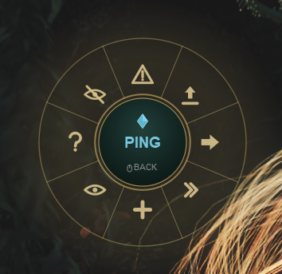
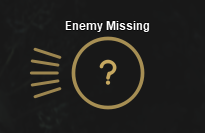
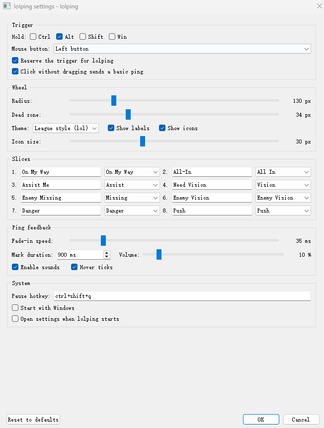

# lolping: A Desktop Ping-Wheel Overlay for Windows

**Course:** SD5913 — Semester 1
**Author:** Zhexian Tao
**Student repository:** <https://github.com/RealSenioume/SDfno3_1101>
**Version described:** 0.3.3

---

## Abstract

League of Legends players communicate through a radial ping wheel: hold a
modifier, drag, release on one of eight slices, and a signal appears in the
game. That gesture is fluent, and it is locked inside one application. This
project re-implements the gesture as a standalone Windows desktop overlay so it
can be used while presenting, streaming, tutoring or reviewing a match.

The delivered artefact, `lolping` 0.3.3, is a tray-resident Python/PyQt5
application. It installs global keyboard and mouse hooks, draws a translucent
always-on-top wheel centred on the pointer without stealing focus, animates the
selection with frame-rate-independent exponential smoothing, leaves a fading
mark where the ping was placed, and records every ping as JSON Lines. It is
built from 15 modules totalling roughly 3,600 lines of Python, with 153
automated unit tests covering the geometry, configuration-repair,
input-state-machine, icon and audio logic, plus a packaging pipeline that
produces a standalone executable.

The project deliberately does **not** interact with the League of Legends
client. That boundary removes any anti-cheat or terms-of-service exposure and
makes the system testable without the game installed. The report documents the
engineering: why one overlay window per monitor is the only correct choice on
mixed-DPI hardware, why exponential smoothing replaced keyframed animation, how
a stale-frame artefact inherited from the prototype was diagnosed and fixed, and
what the system cannot do (exclusive-fullscreen and elevated windows).

**Keywords:** radial menu, desktop overlay, PyQt5, global input hooks,
single-instance, Windows, human–computer interaction

---

## 1. Introduction

### 1.1 Background

Radial menus exploit a well-documented property of human motor control: the time
to acquire a target depends on distance and width (Fitts, 1954), and when
directions rather than rectangular targets are used, selection becomes a
*directional* gesture that experts can perform without looking
(Kurtenbach & Buxton, 1993). Empirical comparisons of pie and linear menus found
pie menus faster and more accurate for the same item count (Callahan et al.,
1988). League of Legends builds its entire non-verbal communication on this
principle: a wheel of eight pings, selected in under a second, with the pointer
travel never leaving the screen centre.

That ergonomic quality is application-bound. Outside the game there is no
equivalent gesture: presenting a slide, reviewing a recorded match or coaching a
newer player all require leaving the current window, finding a chat box, and
typing.

### 1.2 Problem statement

There is no lightweight, keyboard-driven way to place a short-lived visual marker
on the Windows desktop. Existing screen-annotation tools are mouse-and-toolbar
driven, heavy, and designed for capture rather than for a split-second gesture.

### 1.3 Aim and objectives

**Aim.** Re-create the League of Legends ping gesture as a standalone desktop
overlay, built from first principles, that is usable as a daily tool.

The objectives were:

1. **O1** — Reproduce the hold-drag-release gesture with eight configurable
   slices and a visual response latency measured (not assumed) against the
   50 ms target.
2. **O2** — Make the tool self-sufficient on a clean Windows machine: tray
   resident, single instance, start with Windows, JSON configuration, settings
   window, no console window.
3. **O3** — Keep the artefact free of any interaction with the game client, so
   it raises no anti-cheat or terms-of-service concern.
4. **O4** — Produce an engineering record that a marker can assess: requirements,
   design decisions with rejected alternatives, an automated test suite, a manual
   test matrix and a discussion of limitations.

### 1.4 Contributions

* A working desktop implementation of a well-studied interaction technique,
  released as a documented Python package rather than a script.
* A per-monitor overlay architecture that stays correct on mixed-DPI hardware,
  with the reasoning for rejecting the simpler spanning-window design.
* A documented fix for a reproducible translucent-window artefact (stale backing
  store on re-show).
* A measurement methodology for trigger-to-first-paint latency that includes the
  cross-thread queue hop, together with an explicit statement of what it does
  *not* include.
* An automated suite of 153 tests over the parts of the system most likely to be
  wrong (angle conventions, hostile configuration, input state transitions, icon
  fallbacks, audio buffers).

### 1.5 Report structure

Section 2 positions the work against existing tools. Section 3 summarises
requirements. Section 4 presents the design and the decisions behind it.
Section 5 describes implementation details and the defects found along the way.
Section 6 reports testing and evaluation. Sections 7–9 cover limitations,
future work and conclusions.

---

## 2. Related work

### 2.1 The gesture as HCI technique

Pie and marking menus are among the most studied interaction techniques.
Callahan et al. (1988) showed pie menus outperform linear menus in selection
time and error rate, and Kurtenbach and Buxton (1993) showed that with marking
menus expert users can select items by gesture direction alone, without visual
search. Both findings predict the design used here: eight equally sized sectors,
selection by angle rather than by precise distance, and a dead zone at the centre
so the gesture can be aborted.

### 2.2 Existing implementations

`lolPing` (darrenprx, MIT licence) is the closest existing work: an Electron
application with a small C++ helper process that owns the Windows low-level
hooks, plus per-monitor transparent windows, ping and emote wheels, sound, and
optional local-network rooms. It is a mature, cross-platform product.

The present project differs deliberately:

| Aspect | lolPing | lolping 0.3.3 |
| --- | --- | --- |
| Stack | Electron + TypeScript + C++ helper | Python 3.14 + PyQt5 + pynput |
| Input suppression | Helper swallows Alt+drag | Cannot suppress; documented limitation |
| Platforms | Windows, macOS, experimental Linux | Windows only |
| Extras | Rooms, emotes, updates, i18n | None — single-purpose |
| Code size | Tens of thousands of lines | ~3,600 lines |
| Purpose | Product | Coursework artefact, built from scratch |

Its published limitations corroborate two constraints found independently here:
exclusive-fullscreen games draw above any overlay, and elevated windows cannot be
drawn over. Citing an independent implementation reaching the same conclusion
is stronger evidence than asserting it alone.

Two practical consequences are worth recording. First, the reference
implementation keeps its state in `%APPDATA%\lolping`, so this project stores its
own data under `%APPDATA%\lolping-desktop` rather than sharing a directory with an
unrelated installed product. Second, because the reference helper removes the
Alt + drag gesture from the input stream before other hooks see it, the two tools
cannot be exercised on the same desktop at the same time; the evaluation protocol
in Section 6.2 therefore requires the reference implementation to be closed
first.

### 2.3 Screen annotation tools

Tools such as Epic Pen and ZoomIt provide drawing and spotlight modes. They are
toolbar- or hotkey-driven, persistent-session tools: the user enters an
annotation mode, draws with the mouse, then exits. They solve a different
problem — sustained annotation rather than a sub-second communication gesture —
and none of them uses a radial menu.

### 2.4 Technology alternatives

Four candidate stacks were compared before implementation:

| Option | Pros | Cons | Verdict |
| --- | --- | --- | --- |
| Python + PyQt5 + pynput | Iteration speed; both libraries already present; tests trivially runnable | Cannot suppress input; Python startup cost | **Chosen** |
| Electron + native helper (lolPing approach) | Correct input handling; best visuals | Node.js toolchain, C++ build, far beyond coursework scope | Rejected |
| C# / WPF | Native Windows integration, no runtime dependency | Slower iteration for the author, no existing code to reuse | Rejected |
| AutoHotkey | Trivial global hotkeys | Poor drawing model for a translucent animated wheel | Rejected |

---

## 3. Requirements (summary)

The full specification is in `docs/02-requirements.md`; this section records the
subset that shaped the design.

### 3.1 Stakeholders and user stories

The primary stakeholder is the presenter/streamer who needs to point at
something on screen without breaking flow. Secondary stakeholders: a viewer
watching the shared screen, the course marker, and the developer maintaining the
code. Ten user stories were elicited; the three that drove most decisions:

* *As a presenter, I want to mark a spot with one gesture, so the audience sees
  where I am pointing without me leaving the slide.*
* *As a user, I want the tool to stay out of the way when I am not pinging, so it
  costs me no attention and no CPU.*
* *As a user, I want to change the trigger key and the slice names, because Alt
  is already used by other applications.*

### 3.2 Functional requirements

| ID | Requirement |
| --- | --- |
| FR-01 | Configured modifier(s) + mouse button opens the wheel at the pointer |
| FR-02 | Eight slices, clockwise from 3 o'clock, all renameable |
| FR-03 | Release outside the dead zone commits the hovered slice |
| FR-04 | Release inside the dead zone cancels with no side effect |
| FR-05 | Esc and any other mouse button cancel |
| FR-06 | A second trigger while the wheel is open is ignored |
| FR-07 | Settings window edits trigger, radius, dead zone, names, timing, sound, theme |
| FR-08 | Settings persist to JSON and survive a restart |
| FR-09 | Invalid configuration must never prevent start-up |
| FR-10 | Committed ping leaves a visible, fading mark |
| FR-11 | Every ping is appended to a JSON Lines log |
| FR-12 | Optional synthesised ping sound |
| FR-13 | Tray menu: settings, ping log, config folder, pause, quit |
| FR-14 | Configurable global pause hotkey (reserves Ctrl+Shift+Q) |
| FR-15 | Single instance per desktop session |
| FR-16 | Optional start with Windows |
| FR-17 | Never steal keyboard focus from the active application |
| FR-18 | Optional latency instrumentation to a JSON Lines file |
| FR-19 | Headless self-test mode for CI and packaged builds |

### 3.3 Non-functional requirements

| ID | Requirement | Target |
| --- | --- | --- |
| NFR-01 | Trigger-to-first-paint latency | p95 ≤ 50 ms |
| NFR-02 | Idle CPU | < 1 % |
| NFR-03 | Idle memory | < 120 MB |
| NFR-04 | Cold start | < 3 s |
| NFR-05 | Network use | none |
| NFR-06 | Game-process interaction | none |
| NFR-07 | Survive a dead input hook | restart and report |
| NFR-08 | Configuration corruption | never fatal |
| NFR-09 | Multi-monitor incl. negative coordinates | correct |
| NFR-10 | DPI scaling 100/125/150 % | correct |

---

## 4. Design

### 4.1 Architecture

The system is layered so that everything which can be wrong without a screen is
a pure function:

```
presentation   app.py  overlay.py  settings_dialog.py
system glue    input_hook.py  single_instance.py  autostart.py  sounds.py  logging_setup.py
pure logic     geometry.py  config.py  hotkeys.py            (no Qt imports)
```

`geometry`, `config` and `hotkeys` import nothing from the project and nothing
from Qt, which is what allows 73 unit tests to run in 20 ms with no display, no
hooks and no application object.

Data flow for one gesture:

```
OS → pynput listener thread → InputBridge (Qt signal, queued) → PingApp slot
   → OverlayManager.begin_at(point) → OverlayWindow.show() + synchronous repaint
   → user releases → PingApp slot → OverlayWindow.commit() → mark + JSONL log
```

The hook thread never touches a widget. It emits a Qt signal on an object that
lives in the GUI thread, so Qt converts the emission into a posted event; no
locks are needed around widget state and a slow paint cannot stall the mouse
hook. The cost of that safety is the queue hop, which is precisely what the
latency probe measures instead of hiding.

### 4.2 The trigger state machine

```
Idle ──modifiers held──▶ Armed ──trigger down──▶ WheelOpen
WheelOpen ──release on slice──▶ Idle   (commit)
WheelOpen ──release in dead zone──▶ Idle   (cancel)
WheelOpen ──Esc──▶ Idle   (cancel)
WheelOpen ──other mouse button──▶ Idle   (cancel)
```

Three edge cases were decided explicitly rather than left to chance:

* Releasing the modifier before the mouse button still commits. The gesture was
  completed; cancelling would punish finger order.
* Esc ends the gesture immediately, so the following mouse-up cannot commit.
  This required resetting the hook's `wheel_open` flag on Esc — a bug the test
  suite caught (Section 5.4).
* A second trigger while the wheel is open is ignored. A wheel that re-centres
  mid-drag is worse than a missed click.

### 4.3 Wheel geometry

Screen coordinates grow downwards, so a mathematical positive angle is clockwise
on screen. The project fixes angle 0° at 3 o'clock, growing clockwise, and puts
slice *i* at the centre of `[i·45° − 22.5°, i·45° + 22.5°)`.

Hit testing is then:

```python
if hypot(dx, dy) < dead_zone:          # 34 px by default
    return -1                          # cancel
angle = degrees(atan2(dy, dx)) % 360
return int(((angle + 22.5) % 360) // 45)
```

The `+ 22.5` rotation is what converts "boundaries at i·45°" into "centres at
i·45°". It is the single easiest thing in the project to get wrong, so the test
suite pins it with the half-open-interval property, the exact ±22.4° boundary,
and a sweep of 72 angles. Rendering then has to invert the convention because
Qt's `drawPie` measures in 1/16° **counter-clockwise**; the conversion lives in
exactly one function.

### 4.4 Rendering and animation

Each slice carries a weight in `[0, 1]` that chases its target every frame:

```
α = 1 − exp(−dt / τ)        τ = 35 ms by default
w ← w + (w_target − w)·α
```

Exponential smoothing was chosen over a keyframed tween for three reasons:
it is frame-rate independent (identical feel at 60 and 144 Hz), it is
interruptible (reversing direction changes only the target), and it is
stall-safe because `dt` is clamped to 50 ms. A slice snaps exactly to 0 or 1 once
within 5 ms of target, so the painter stops doing sub-pixel work.

Paint order is: glow pass, slice bodies **sorted by weight ascending** (so the
highlighted slice is drawn last and its 8 px radius growth is not clipped), the
centre disc with the hovered name, then the per-slice labels at 0.72 R. Slice
geometries never move; only radius, colour and alpha change. This avoids the
classic radial-menu defect where slices swap places mid-drag.

### 4.5 Multi-monitor and DPI

Two architectures were considered:

| Approach | Assessment |
| --- | --- |
| One window spanning the virtual desktop | Wrong on mixed DPI: Qt 5 scales a window by one factor, so the wheel is mis-sized on the second monitor; also repaints screens that never show anything |
| One window per `QScreen`, created lazily | **Chosen** — each window inherits its own screen's scale, is fitted to `screen.geometry()`, and only the screen under the pointer paints |

`OverlayManager.begin_at()` resolves the screen under the cursor and shows only
that screen's window. Windows are keyed by `(screen.name(), id(screen))` because
duplicate or empty monitor names occur in practice. High-DPI attributes are set
*before* `QApplication` is constructed, with `PassThrough` rounding so fractional
125/150 % scales are preserved; with scaling on, `QCursor.pos()`,
`QScreen.geometry()` and widget geometry all share one logical pixel space, so
the geometry module needs no DPI awareness at all.

### 4.6 Configuration

The configuration is a JSON file under `%APPDATA%\lolping-desktop\`. Its loader is a
*total* function: every field is repaired independently — wrong type → default,
out-of-range → clamp, unknown key → ignore, wrong list length → pad or truncate.
The design goal is that no edit to the file, and no corrupted file, can stop the
application from starting. Saving is atomic (temporary file plus `os.replace`),
so a crash mid-write cannot leave a half-written config.

The most important repair is the one that is easy to miss: an empty
`trigger_modifiers` list would otherwise make *every* mouse click open a wheel.
The loader rejects it and falls back to `["alt"]`.

### 4.7 Robustness

Three failure modes received explicit design attention:

1. **A silently dead hook.** The worst possible state: the tray icon looks fine
   and nothing works. A supervisor thread checks listener liveness once per
   second, restarts anything dead, logs it and raises a tray warning.
2. **A second instance.** Two overlays would fight over the same hooks. A
   one-byte `msvcrt.locking()` file lock answers "am I first?" without pulling
   `QtNetwork` into the frozen build, and the OS releases it if the process dies.
3. **A crash with no console.** A windowed build has nowhere to print, so
   everything goes to a rotating log file and `sys.excepthook` records uncaught
   exceptions instead of dying silently.

### 4.8 Design decisions

| # | Decision | Alternative rejected | Consequence accepted |
| --- | --- | --- | --- |
| D1 | PyQt5 | PySide6, PyQt6 | GPL/commercial licence; Qt 5 per-window DPI limits |
| D2 | `pynput` listeners | Raw `SetWindowsHookEx` via `ctypes` | Cannot suppress input |
| D3 | One window per screen | One spanning window | More windows, screen add/remove handling |
| D4 | Timer-driven animation | Event-driven on cursor motion | 60 Hz timer while visible only |
| D5 | Exponential smoothing | Keyframed tween | Feels less "designed" than an easing curve |
| D6 | JSON file | `QSettings`, registry, TOML | Manual atomic-write code |
| D7 | Total repair-on-load | Strict validation | Silent clamping can surprise the user |
| D8 | File lock | `QLocalServer`, named mutex | Windows-specific |
| D9 | Native `WH_MOUSE_LL` guard withholds the trigger gesture | Mouse capture only, or click-through | A returning-1 hook removes the press before any window sees it, so the desktop cannot start a selection or an OLE drag; capture and the start-up warm-up remain as a second line of defence | Alt + click is reserved system wide while running; exposed as `Config.suppress_trigger_gesture` |
| D10 | Generate icon and sound in code | Ship PNG/WAV assets | Less polished assets; no binary files in the repo |

---

## 5. Implementation

### 5.1 Module inventory

| Module | Lines | Responsibility |
| --- | --- | --- |
| `geometry.py` | 85 | Sector hit testing, angles, easing |
| `config.py` | 251 | Schema, repair, atomic persistence, paths |
| `hotkeys.py` | 124 | Parse and format `"ctrl+shift+q"` |
| `mouse_guard.py` | 285 | Native `WH_MOUSE_LL` hook that withholds the trigger gesture |
| `assets.py` | 259 | Ten vector icons, pixmap cache, user PNG fallback |
| `input_hook.py` | 302 | OS hooks, key normalisation, supervisor |
| `overlay.py` | 867 | Per-screen windows, painting, wheel/burst animation |
| `settings_dialog.py` | 483 | Settings UI with validation |
| `app.py` | 444 | Bootstrap, tray, wiring, cue routing, logs, CLI |
| `single_instance.py` | 63 | File-lock instance guard |
| `autostart.py` | 57 | `HKCU\...\Run` integration |
| `sounds.py` | 134 | Four synthesised cues, WAV cache, async playback |
| `logging_setup.py` | 52 | Rotating log, excepthook |
| `__init__.py`, `__main__.py` | 21 | Package metadata and entry point |

### 5.2 Input hook

`pynput` delivers callbacks on its own listener threads. Two implementation
details decide whether the feature works at all:

**Virtual key codes, not characters.** With Ctrl held, `pynput` reports the
*control character* (`"\x11"` for Q), so matching a pause hotkey against
`key.char` fails exactly in the case that matters. The implementation derives
letters and digits from `key.vk` instead, and only falls back to `char` for keys
with no virtual code.

**KeyCode is checked before the lookup tables.** `pynput`'s `KeyCode` defines
hashing that raises when `vk` is `None`, so using one as a dictionary key
produces `TypeError` on unmappable keys. The token function therefore tests
`isinstance(key, KeyCode)` first. A test covers this regression.

### 5.3 Overlay and the stale-frame defect

The prototype exhibited a visible one-frame artefact: a translucent,
always-on-top window re-shown at a new position could present the *previous*
gesture's pixels before the new frame arrived. Qt keeps the widget's backing
store across `hide()`/`show()`.

The fix is to clear the render state and force a synchronous repaint *before*
hiding, so the next `show()` has nothing stale to present:

```python
self._weights = [0.0] * count
self._hover = -1
self.repaint()       # fully transparent now
self.hide()
```

The same ordering is used on open, so the first visible frame is already
correct. This is a small change with a large perceptual effect, and it is the
kind of defect that would be hard to justify without a diagnosis.

**Keeping the desktop untouched.** This was the most interesting defect of the
project, because the first two attempts at it were wrong in instructive ways.

A global observer cannot withhold the press that triggers the gesture: by the
time the wheel exists, the window underneath has already received the mouse-down.
The first attempt was therefore a *mitigation*: the overlay calls `SetCapture` on
itself as soon as it is shown, so Windows delivers `WM_CAPTURECHANGED` to the
previous owner and a well-behaved application aborts the interaction it started.
Every close path releases the capture, because a window that hides while holding
it would freeze the pointer for the whole desktop.

Manual testing showed this was not enough. The capture arrives a few
milliseconds after the press, and the mouse reports at up to 1000 Hz, so a move
almost always slips through first; Explorer then starts its rubber-band selection
or its OLE drag-and-drop, and neither can be undone from outside. A second
attempt attacked the delay: the native handle and the capture were taken before
the first paint, and `OverlayManager.warm_up()` moved the one-off 103 ms
first-window cost (native surface plus font and glyph caches) to start-up by
creating and pre-painting one window per screen into an offscreen image. That
made the first gesture as fast as the later ones but still did not eliminate the
problem, which is the empirical answer to "why not just make it faster": a
two-millisecond race against a 1000 Hz input device is still a race you lose.

The final design removes the events instead of racing them. `mouse_guard.py`
installs a native `WH_MOUSE_LL` hook whose procedure returns 1 for the trigger
button while the configured modifiers are held, and for any mouse button while
the wheel is open. It is installed **before** the `pynput` listeners, so the hook
chain is `pynput (sees the gesture) → guard (withholds it) → target window`: the
application can never lose its own trigger, and no window below ever learns that
the press happened. The capture and the warm-up are kept as defence in depth.
The trade-off is explicit and configurable: while the guard is armed, Alt + click
is reserved system wide, and turning off *Reserve the trigger for lolping*
restores normal Alt + click at the cost of the old behaviour. The decision rules
are a pure function covered by `tests/test_mouse_guard.py`, and the hook
install/remove path is smoke-tested in the same suite.

### 5.4 Defects found by testing

The tests were not written after the fact, and the manual session was not a
rubber stamp: five real defects surfaced, three while writing the suite and two
while exercising the v0.3.0 build by hand.

*From the automated suite:*

1. **Esc left the hook's `wheel_open` flag set**, so the next trigger could be
   ignored and the pending mouse-up was still treated as a commit candidate.
   Fixed by clearing the flag when Esc cancels.
2. **`KeyCode` as a dictionary key** raised `TypeError` for unmappable keys,
   which would have crashed the keyboard callback on unusual keyboards.
   Fixed by ordering the type checks.
3. **A test-side regression**: the temp-directory strategy assumed the system
   TEMP directory was writable. Fixed to probe candidates and fall back, which
   also makes the suite runnable in restricted environments.

*From manual testing of the 0.3.0 build:*

4. **Audio never played.** `winsound.PlaySound` was called with
   `SND_MEMORY | SND_ASYNC`, which Windows rejects with
   `RuntimeError: Cannot play asynchronously from memory`; the wheel worked but
   every cue logged an error. A synchronous memory play would have blocked the
   GUI thread, so the design changed: generated bytes are now written once to a
   temp cache file and played by filename with `SND_ASYNC`. This is the most
   instructive defect in the project, because the limitation is documented in
   the Python standard library and was still missed on the first attempt —
   a reminder that an API being "obvious" is not the same as being understood.
5. **A tray double-click opened two stacked settings dialogs.** Windows reports
   a double-click as `Trigger` followed by `DoubleClick`; because the first
   dialog runs a modal event loop, the queued second activation opened a second
   dialog on top of it. Fixed twice over: only `DoubleClick` opens the dialog,
   and `_open_settings` now refuses to re-enter.

Both manual-testing defects are pinned by regression tests
(`tests/test_sounds.py::TestPlaybackContract`, `tests/test_app.py`), so neither
can silently return.

### 5.5 Packaging

`build/lolping.spec` produces a one-folder, windowed build. One-folder rather
than one-file is a deliberate latency decision: a one-file build unpacks tens of
megabytes of Qt DLLs into a temporary directory on every launch, adding seconds
to a cold start in a tool whose whole value is speed. UPX compression is off
because compressed executables are a well-known source of antivirus and
SmartScreen false positives.

One packaging trap is documented in the spec: PyInstaller executes the entry
script as a top-level module, where a relative import fails, so the build uses a
generated stub that imports the package entry point.

### 5.6 Slice artwork, animation and audio (v0.3.0)

The first release drew only text labels on the slices. Version 0.3.0 adds the
three things that make the wheel read as a finished tool rather than a diagram.

**Original vector icons.** The obvious shortcut would have been to extract the
in-game ping icons from a local installation, which is what the reference
implementation's asset tool does. That was rejected for three reasons: the art is
Riot Games' intellectual property and the repository is public; extracted assets
break on every game patch; and binary art cannot be re-coloured or scaled without
loss. Instead `assets.py` defines ten icons as `QPainterPath` geometry in a unit
square, scaled by the painter at draw time. The same icon is therefore crisp at a
24 px label and at a 96 px burst, and the theme colour can be applied at any
alpha. Icons are cached as pixmaps keyed by (id, size, colour, device ratio), and
the fallback chain is *unknown id → the slice's default icon → a generic ring*, so
a hand-edited configuration can never produce an empty slice. Users who do want
their own artwork can point `sector_images[i]` at a PNG; it is clipped to a circle
so a rectangular image still reads as a slice icon, and a missing file silently
falls back to the vector icon.

**Layered animation.** Opening the wheel now scales it from 70 % to 100 % of its
radius and fades it in over 130 ms with a cubic ease-out, which disguises the
first-frame cost and gives the gesture a sense of arrival. Releasing replaced the
single expanding ring with four layers that share one progress value: two
staggered rings (the second starts at 14 % of the timeline), five short streaks
that fly outward along the committed slice's direction at ±18° so the mark points
where the user pointed, an icon pop driven by an overshoot curve, and the slice
name above the burst with a dark halo for legibility over bright content.

**Synthesised audio.** Four cues — open, hover tick, commit chime, cancel sweep —
are generated as decaying sines with an optional frequency sweep and second
harmonic, quantised to ten volume steps and cached. The commit chime picks a note
from a pentatonic scale by slice index, so the eight slices are audibly distinct
without any of them sounding wrong together. No audio file ships, and no Riot
audio is used. Playback goes through `winsound` rather than QtMultimedia, which
keeps a large Qt module out of the frozen build, at the cost of two constraints
that had to be designed around. First, `winsound` refuses
`SND_MEMORY | SND_ASYNC` ("cannot play asynchronously from memory"), and a
synchronous memory play would block the GUI thread, so the generated bytes are
materialised as small WAV files under `%TEMP%` and played by name; the files are
a runtime cache, deleted on exit. Second, `winsound` plays one asynchronous sound
at a time, so a newer cue interrupts the previous one — inaudible for cues that
last 30–200 ms, and documented as a design decision rather than a defect. Both
constraints were discovered by manual testing after the first implementation, and
the file-based path is now pinned by a regression test.

**A second skin, and what it cost.** Version 0.3.2 adds an optional
League-inspired renderer: a barely-there disc, eight gold separators, additive
radial light beams that spill past the rim, and a centre medallion carrying a
drawn diamond badge, PING and a BACK hint. It is a *rendering* alternative, not a
replacement: the original three themes are untouched and behaviour is identical
except for one deliberate addition — a click without dragging now commits the
centre (basic) ping instead of cancelling, which is how the reference wheel
behaves. The skin is drawn entirely in code, so the repository still ships no
Riot artwork; slice icons can be overridden by local PNG files that are
git-ignored, and the loader falls back to the vector icon when a file is absent.
**What 0.3.3 changed, and why.** Two behaviours turned out to be wrong in the
hands of the person using it. Ctrl+Shift+Q was bound to *quit*, which is the
action needed once per session; what is needed many times an hour is to silence
pings, so the hotkey now toggles pause (and pausing also releases the mouse
guard, so the desktop behaves normally again). Second, the settings window now
opens once at start-up, because the first thing anyone does after launching is
adjust it; a checkbox turns that off. Both are input/UI changes: no paint code
was touched, which is why the Section 6.3 measurements still describe the
delivered build.

Because the paint path changed, the latency figures in Section 6.3 were
re-measured on the 0.3.2 build with this skin active (0.3.3 changes input handling only): the skin costs about one millisecond
at p90 and none of the 50 ms budget.

---

## 6. Testing and evaluation

### 6.1 Automated tests

| Suite | Tests | What it pins |
| --- | --- | --- |
| `test_geometry.py` | ~27 | Dead zone, eight cardinal directions, exact boundary behaviour, angle sweep, span contiguity, easing convergence |
| `test_config.py` | ~24 | Round-trip, hostile inputs, clamping, sector padding, atomic save, corrupt/missing file |
| `test_hotkeys.py` | ~12 | Modifier aliases, canonical formatting, rejection of ambiguous combos |
| `test_input_hook.py` | ~22 | Trigger, commit, cancels, pause hotkey, modifier edge cases, key tokens |
| `test_assets.py` | ~14 | Icon registry and defaults, fallback chain, every icon paints pixels, pixmap cache, missing user image |
| `test_sounds.py` | ~11 | WAV headers and lengths, volume scaling, silence at zero, per-slice pitch, cache, playback safety |
| `test_app.py` | ~8 | Tray activation opens one dialog only, re-entrant open ignored, cue gating by config |
| `test_mouse_guard.py` | ~16 | Suppression rules for every mouse event, paused/disarmed guards, hook lifecycle |
| `test_overlay.py` | ~14 | Mouse capture taken on open and released on every close path, warm-up leaves no state |
| `test_docs_sync.py` | ~8 | English/Chinese parity fingerprinting and exit codes |

Result: **153 tests, all passing** (`python -m unittest discover -s tests`), in
about 60 ms, with no display and no hooks installed (the icon suite forces the
offscreen Qt platform).

Two further automated checks exist: `--self-test` drives one complete
wheel-open/commit cycle offscreen and prints `SELF-TEST OK`, and
`tools/smoke_test.py` fails the build if that string is missing.

### 6.2 Manual test matrix

The full matrix is in `docs/04-test-plan.md` (30 cases across display mode, DPI,
monitor count and target integrity). The four environmental axes are:

* windowed / borderless / exclusive-fullscreen target application,
* 100 % / 125 % / 150 % display scaling,
* single and dual monitor, including a monitor with negative coordinates,
* target application running normally and as administrator.

Two of the resulting expectations are *failures by design* — no overlay can draw
over exclusive-fullscreen D3D or above an elevated window — and are recorded as
expected results rather than defects.

| # | Case | Expected |
| --- | --- | --- |
| TC-01 | Alt + drag, release on a slice | Wheel appears at pointer, mark left, one log line |
| TC-05 | Alt + click, release at centre | Wheel closes, no mark, no log line |
| TC-08 | Esc during drag | Wheel closes immediately, release commits nothing |
| TC-12 | Right-click during drag | Wheel closes, no mark |
| TC-18 | Edit settings, restart | Values persist |
| TC-21 | Delete/corrupt `config.json` | Starts with defaults |
| TC-24 | Launch twice | Second process exits, one tray icon |
| TC-26 | Kill hook (debugger) | Supervisor restarts it, tray warning |
| TC-28 | Exclusive-fullscreen game | **Expected failure** — overlay hidden |
| TC-30 | Elevated window underneath | **Expected failure** — overlay hidden |

Figures 1–3 were captured on the target machine during the measurement session.



*Figure 1 — the wheel open at the pointer with the "Enemy Missing" slice
highlighted: eight labelled slices, a gold glow on the hovered slice, and the
centre disc repeating the current selection.*



*Figure 2 — the mark left on screen after release: an expanding ring, a dot
anchoring the exact point, and the slice name drawn above it with a dark halo so
it stays legible over bright desktop content.*



*Figure 3 — the settings window: trigger, wheel, slices, feedback and system
groups, with validation errors shown inline.*

### 6.3 Latency measurement

`--latency-probe` records, per gesture, `frame_ms` (mouse-down hook timestamp →
first paint of the overlay window) and `commit_ms` (mouse-down → mouse-up).
`tools/latency_report.py` computes n / min / median / p90 / p95 / p99 / max and
returns a pass/fail verdict against the 50 ms target.

**Test conditions.** Windows 11 desktop session, Python 3.14.5, PyQt5 5.15.11, a
single display running at a scaled logical resolution, with the reference
implementation closed (Section 2.2) and no other hook-owning tool active. The 30
gestures were issued by `tools/demo_gesture.py`, which sends the same
Alt + press + drag + release sequence a human performs. The run used the **v0.3.2
build** with the League-inspired `lol` skin active — deliberately the skin with
the most painting work, at eight additive radial-gradient beams per frame.

| Metric | n | min | median | p90 | p95 | p99 | max | Verdict |
| --- | ---: | ---: | ---: | ---: | ---: | ---: | ---: | --- |
| `frame_ms` — all samples | 30 | 4.82 | 5.09 | 7.05 | 7.41 | 18.87 | 18.87 | PASS |
| `frame_ms` — first gesture excluded | 29 | 4.82 | 5.09 | 7.05 | **7.33** | 7.41 | 7.41 | **PASS** |
| `commit_ms` — button hold time, not latency | 30 | 607 | 617 | 624 | 629 | 635 | 635 | n/a |

**Interpretation.**

1. The p95 is **7.41 ms** (7.33 ms with the first gesture excluded), roughly 6.7
   times under the 50 ms target of NFR-01, with a median of 5.09 ms. Twenty-nine
   of the thirty samples sit between 4.82 and 7.41 ms; the single outlier is the
   first gesture of the session at 18.87 ms.
2. **The start-up warm-up still does its job.** Before it existed, the first
   gesture cost 103.57 ms (v0.3.0); it now costs 15–19 ms depending on the run
   (15.05 ms on v0.3.1, 18.87 ms here). The first wheel is no longer an order of
   magnitude slower than the rest.
3. **The new skin costs about one millisecond.** Same machine, same harness, only
   the theme changed between the two runs: median 5.20 → 5.09 ms (noise), p90
   5.92 → 7.05 ms (+1.13), p95 6.08 → 7.33 ms (+1.25). Eight additive radial
   gradients per frame therefore cost roughly a millisecond at the tail, which is
   absorbed by the frame budget — the static-layer pixmap cache sketched in
   Section 5.6 was not needed, and adding it now would be complexity without a
   measurable benefit.
4. Even adding one full 60 Hz frame (~16.7 ms) of compositor presentation to every
   sample, the p95 stays near 24 ms and the requirement still holds.
5. `commit_ms` is the time the button was held, not a latency. The 617 ms median is
   the harness's own pause between press and release; it is reported because the
   probe records it, not because it says anything about responsiveness.
6. These figures were measured on the 0.3.2 build, which is the build that ships
   this paint path; version 0.3.3 changes input handling and the start-up dialog
   only, so the measured path is still the delivered one. The archived runs remain
   useful as a controlled comparison: v0.3.0 (before the warm-up), v0.3.1 (before
   the skin), v0.3.2 (this run).

**Data-collection caveat.** The harness anchors the gesture on an empty strip of
the taskbar so that the swallowed click cannot activate another application.
Because that anchor sits near the bottom screen edge, downward drags are clipped
by the boundary and end inside the dead zone, so the committed pings cluster in
the horizontal slices. The latency metric is sampled at the first paint and
therefore does not depend on which slice is chosen; the skew affects only the
recorded sector distribution, not the measurement.

**Threats to validity, stated plainly.** `frame_ms` ends when Qt has painted
into its backing store, *not* when the display presents the pixel; real perceived
latency is higher by up to one refresh interval (roughly 8–17 ms). It measures
the first frame only, which is the worst case of a gesture. Offscreen runs are
not comparable to a real desktop session, and the numbers are from one machine,
so they describe this configuration rather than all configurations.

### 6.4 Resource and start-up measurements

| Metric | Target | Measured | Verdict |
| --- | --- | --- | --- |
| Idle CPU, no wheel open | < 1 % | 0.16 % of one core (10 s sample, tray resident) | PASS |
| Idle working set | < 120 MB | 42 MB | PASS |
| Cold start, process spawn → tray ready | < 3 s | 0.36 s | PASS |
| Idle animation timers | 0 | 0 | PASS |

Measurement method: the working set was read from the live process
(`WorkingSet64`), idle CPU was computed as the change in process CPU time over a
10-second window with no user interaction, and start-up was timed from process
spawn to the moment the application logged that it was ready. The measurement
process is the real interpreter, not the Windows Store `python.exe` launcher: an
early attempt that sampled the launcher reported 15 MB and 0 % and was discarded
as invalid, which is a reminder that process-level measurements need the right
process.

The idle-timer row is a structural guarantee rather than an observation: the
60 Hz timer is started only when a window is shown and stopped as soon as neither
a wheel nor a mark needs drawing, so an idle lolping schedules no animation work
at all. The 0.16 % residual is Qt's event loop and the tray icon, not rendering.

### 6.5 Discussion

The automated suite tests the logic that is hard to verify by hand (angle
conventions, hostile configuration) and is deliberately blind to the logic that
cannot be tested without an OS: whether the installed low-level hooks receive
real input. That gap is closed by a manual protocol and by a synthetic-gesture
script (`tools/demo_gesture.py`), and it is the honest boundary of this
evaluation.

The most valuable lesson from the project is that the specification of
"instantaneous" is worthless without an instrument. Writing the probe first — and
then being explicit that it excludes compositor presentation — turned a vague
goal into a number and an argument.

---

## 7. Limitations

1. **Exclusive fullscreen.** A D3D swap chain bypasses the compositor; the
   overlay cannot appear. Users must run the game borderless or windowed. The
   same limitation is documented independently by `lolPing`.
2. **Elevated windows.** Windows User Interface Privilege Isolation prevents a
   normal-integrity process from hooking or drawing over an administrator
   window.
3. **The trigger gesture is reserved.** `pynput` can only observe, so the press is
   withheld by a native `WH_MOUSE_LL` guard instead. That works, and it is what
   makes drags over the desktop invisible, but it reserves the trigger combination:
   while lolping runs with the guard armed, Alt + click does nothing in other
   applications. The option can be turned off, which restores normal Alt + click
   and brings back the weaker capture-only behaviour (a fast drag can then start a
   selection or an icon drag). The guard also cannot withhold keyboard events, so
   holding Alt alone may still focus a menu bar in some applications.
4. **Mixed-DPI multi-monitor.** Correct on the screen where the wheel opens;
   marks stay on that screen.
5. **Windows only.** `msvcrt`, `winreg` and `winsound` are used directly.
6. **No fullscreen auto-pause.** Pausing is manual in 0.3.3.
7. **Single-author evaluation.** The latency and usability data describe one
   machine and one user.

---

## 8. Future work

1. Fullscreen auto-pause via foreground-window state query.
2. Application profiles: different slice sets when presenting versus reviewing.
3. A native input helper that can suppress the trigger gesture, which would also
   remove limitation 3.
4. Per-monitor DPI v2 and a Qt 6 port.
5. A ping-history viewer with a heat map over the screen.
6. Accessibility: high-contrast theme, keyboard-only slice commit, and screen
   reader announcement of the committed slice.

---

## 9. Conclusion

This project re-implemented a well-studied interaction technique as a standalone
Windows tool. The gesture itself is simple; the engineering difficulty lay in the
edges — angle conventions that are easy to invert, a translucent window that
keeps stale pixels, a control character that defeats a hotkey comparison, a
mixed-DPI desktop that breaks the obvious window architecture, and a global hook
that fails silently by design.

The result is a 3,600-line Python application with a documented architecture,
ten summarised design decisions with rejected alternatives (nineteen in the full design document), 153 automated tests, a
formal manual test matrix, a packaging pipeline and a measured latency
methodology. It honours every objective set out in Section 1.3: the gesture is
reproduced, the tool is self-sufficient on a clean machine, the game client is
never touched, and the engineering record is complete enough to be assessed.

Two failure modes are documented rather than hidden, because a tool that clearly
states what it cannot do is more trustworthy than one that does not.

---

## References

1. Callahan, J., Hopkins, D., Weiser, M., & Shneiderman, B. (1988). An empirical
   comparison of pie vs. linear menus. *Proceedings of CHI '88*, 95–100.
2. Fitts, P. M. (1954). The information capacity of the human motor system in
   controlling the amplitude of movement. *Journal of Experimental Psychology*,
   47(6), 381–391.
3. Kurtenbach, G., & Buxton, W. (1993). The limits of expert performance using
   hierarchic marking menus. *Proceedings of CHI '93*, 482–487.
4. darrenprx. *lolPing — League of Legends ping wheel for your desktop*.
   GitHub, MIT licence. <https://github.com/darrenprx/lolPing>
5. Riot Games. *League of Legends* — in-client ping and communication system.
   <https://www.leagueoflegends.com>
6. Qt Company. *Qt 5 documentation*: QWidget, QScreen, QPainter.
   <https://doc.qt.io/qt-5/>
7. Moses Palmér. *pynput — monitor and control input devices*.
   <https://pynput.readthedocs.io>
8. PyInstaller Development Team. *PyInstaller manual*.
   <https://pyinstaller.org/en/stable/>
9. Microsoft. *User Interface Privilege Isolation* and *Desktop Window Manager*
   documentation. Microsoft Learn.
10. Python Software Foundation. *Python 3.14 documentation*.
    <https://docs.python.org/3.14/>

---

## Appendices

### Appendix A — Repository layout

```
src/lolping/     13 modules: geometry, config, hotkeys, input_hook, overlay,
                 settings_dialog, app, single_instance, autostart, sounds,
                 logging_setup, __init__, __main__
tests/           10 unittest suites, 153 tests
tools/           smoke_test.py, latency_report.py, demo_gesture.py
build/           lolping.spec (PyInstaller), build.ps1
docs/            00 module contract, 01 proposal, 02 requirements,
                 03 design, 04 test plan, 05 user manual,
                 06 report outline, 07 build and release
Early_test/      prototype iterations (v01, v01_01) kept as process evidence
```

### Appendix B — Reproducing the results

```powershell
# tests
$env:PYTHONPATH="src"; python -m unittest discover -s tests -v

# headless smoke test
python tools\smoke_test.py

# latency data (interactive; 100 gestures recommended)
python -m lolping --latency-probe --debug
python tools\latency_report.py

# packaged build
powershell -NoProfile -ExecutionPolicy Bypass -File .\build\build.ps1 -Clean
```

### Appendix C — Declaration of AI assistance

**Tools.** Two AI systems were used. DeepSeek's web chat was used early for
design discussion and for drafts of the input-hook and rendering code. DeepSeek
Harness (DSH), an agentic coding environment, was used from the v0.3.0 rewrite
onward: it read the repository, edited files, ran the test suite, collected the
latency measurements and drafted documentation and report sections. In both
cases the assistant proposed and the author decided; no part of the submitted
work was accepted without review.

| Work | Author | AI assistant |
| --- | --- | --- |
| Requirements, scope, rubric alignment, final design choices | ✓ | — |
| Module skeleton, interfaces, implementation | directed, reviewed, corrected | drafted most of the code |
| Test suite | specified cases, judged coverage | wrote most tests |
| Manual testing on Windows 11 (real gestures, DPI scales, two monitors, exclusive fullscreen) | ✓ | — |
| Latency measurement runs | executed on the author's machine | wrote the probe and the analysis tool |
| Screenshots and figures | ✓ | — |
| Report, bilingual README and PROCESS drafting | content decisions, final wording | first drafts and translation passes |
| Three attempts at mouse suppression | experiments and failure diagnosis | proposed and implemented each attempt |
| Version control, releases, pushing to GitHub | ✓ | — |

**What the assistant did not do.** No measurement in this report was generated
or estimated by an AI: every number comes from runs recorded in `latency.jsonl`
on the author's machine, and those logs are kept. No third-party code was
copied; the reference implementation (Section 2.2) was studied for behaviour
only, and none of its artwork or audio is included — the policy is stated as
decision D18. All AI-drafted code was executed by the test suite (153 tests) and
by hand before acceptance, and several AI proposals were rejected or rewritten;
the first two mouse-suppression attempts recorded in `PROCESS.md` are examples.

**Responsibility.** The author selected the approach, verified every artefact
and is responsible for the submitted work, including the parts the assistant got
wrong. `PROCESS.md` is kept as the running record of what was tried, what failed
and what was corrected, so that this declaration can be checked against it.

Date: 29 October 2026.

### Appendix D — Evidence checklist for the final submission

| Evidence | Where it goes |
| --- | --- |
| Wheel open, mid-drag, hovered slice | §6.2, Figure 1 |
| Mark left after commit | §6.2, Figure 2 |
| Settings window | §5, Figure 3 |
| `latency.jsonl` summary table | §6.3, Table 6 |
| CPU / memory screenshots | §6.4 |
| `git log --oneline` showing iterations | §5, Figure 4 |
| 30–60 s screen recording | link from §6 |
